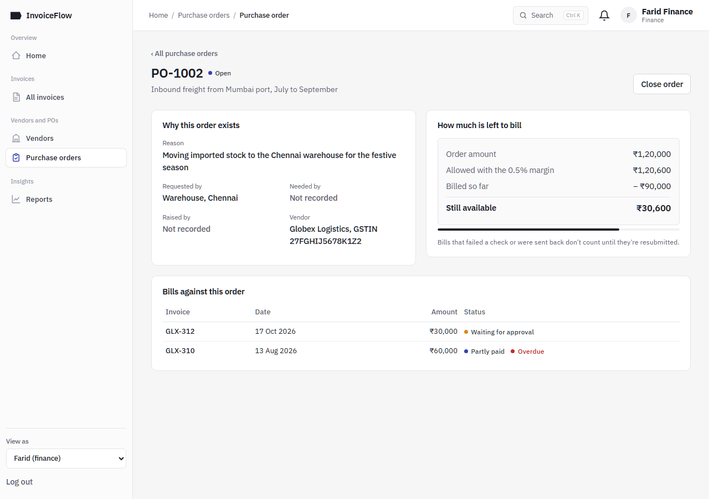
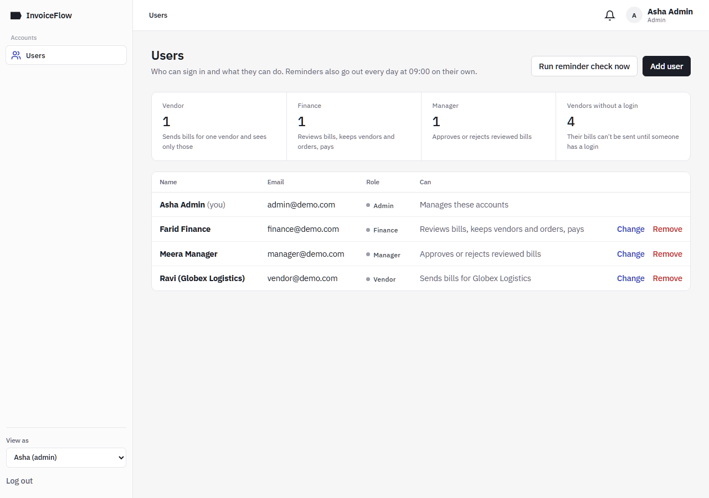

# InvoiceFlow: Invoice Verification and Vendor Payment Platform

**Project report, Full Stack Development (FSD)**

Built with MongoDB, Express.js, React and Node.js (MERN)

---

## Table of contents

1. Abstract
2. Problem statement
3. Objectives
4. Scope and limitations
5. Existing system vs proposed system
6. Technology stack
7. System architecture
8. Modules
9. Database design
10. API reference
11. Invoice state machine
12. Verification rules
13. Security measures
14. Testing
15. Screenshots
16. Conclusion
17. Future enhancements
18. References

---

## 1. Abstract

Many businesses still track vendor invoices in spreadsheets, email threads and paper files. Because of this, invoices wait for approval longer than they should, payments miss their due dates, and duplicate or wrong bills slip through. **InvoiceFlow** is a web application that automates this accounts-payable process.

- **Vendor submission:** vendors send their own bills, with line items, GST and the purchase order each bill is for.
- **Verification:** when an invoice is submitted, the system checks it automatically. It confirms the vendor is active, the invoice is not a duplicate, the dates and amount are valid, and the total stays within its purchase order.
- **Review and approval:** invoices that pass every check go to finance for review, then to a manager, who approves or rejects them with a reason.
- **Payment:** finance records partial or full payments, and the system blocks overpayment.
- **Reminders:** a scheduled job flags invoices that are due soon, overdue, or stuck waiting for approval.
- **Reporting:** reports show what is owed, how overdue it is, and how long approval and payment take.

The application is built with MongoDB, Express, React and Node, with role-based access for Vendor, Finance, Manager and Admin users. Its data is stored in MongoDB Atlas.

## 2. Problem statement

> Businesses often experience delays in invoice approvals and vendor payments due to manual tracking. The platform should automate invoice verification, payment status tracking, reminders, and financial reporting.

Manual tracking causes these problems:

- **No single view of status.** Nobody can quickly tell whether an invoice is waiting for approval, approved, partly paid or paid.
- **Errors found late.** Duplicate bills, bills from inactive vendors and bills that exceed the purchase order are found after payment, or not at all.
- **Approvals stall.** Approvers are not reminded, so invoices sit unattended.
- **Missed due dates.** Late payments damage vendor relationships and can attract penalties.
- **No analytics.** Management cannot see outstanding liabilities, how overdue they are, or how long the process takes.

## 3. Objectives

1. Verify every invoice automatically against business rules as soon as it is entered.
2. Send only checked, finance-reviewed invoices to managers, and keep a complete audit trail of who did what and when.
3. Track payment status, including partial payments, and block overpayment.
4. Remind the right role about invoices that are due soon, overdue, or waiting too long for review or approval.
5. Provide reports on what has been paid, what is outstanding, how overdue it is, and how long each stage takes.
6. Enforce role-based access on the server.

## 4. Scope and limitations

**In scope**
- Vendor and purchase order (PO) management, with the reason and requester recorded for every PO
- A vendor portal: vendors submit their own invoices (line items, GST, an optional PDF/PNG/JPEG copy) and see only their own data
- Automatic verification, finance review, manager approval and rejection, and payment recording
- In-app notifications and a daily reminder job, which an admin can also run on demand
- A dashboard, reports and a CSV export
- Four roles (Vendor, Finance, Manager, Admin) with JWT authentication

**Limitations (deliberately out of scope)**
- Reminders appear in the app only; there is no email or SMS.
- Invoice data is typed in by hand; nothing is read from the PDF (no OCR).
- GST is recorded per line as one rate; it is not split into CGST/SGST or IGST.
- A single currency (INR) is used.
- No real payment gateway is connected; payments are recorded, not made.
- The app runs locally in development mode and is not yet deployed to a public host.

## 5. Existing system vs proposed system

| Aspect | Existing (manual) system | Proposed system (InvoiceFlow) |
|---|---|---|
| Invoice entry | Spreadsheets, email attachments, paper | The vendor fills in one form, with line items, GST and an attached copy of the bill |
| Verification | Done by eye, often skipped | 4–5 automatic rule checks on every submission |
| Duplicate detection | Depends on memory | Automatic, per vendor |
| PO matching | Manual comparison | Automatic, with 0.5% tolerance across all invoices on the PO |
| Approval | Email or verbal, easy to forget | Finance review, then a manager's approval queue; notifications; every decision and reason recorded |
| Payment tracking | Separate ledger | Partial and full payments on the invoice; overpayment blocked |
| Reminders | None | Daily job: due soon, overdue, review or approval waiting more than 2 days |
| Status visibility | Ask around | Payment route dashboard, per-invoice progress tracker |
| Reporting | Built by hand at month end | Live reports and CSV export |
| Access control | Shared files | Roles enforced on the server (JWT) |

## 6. Technology stack

| Layer | Technology | Why it was chosen |
|---|---|---|
| Frontend | React 18 | Component model suits a page made of reusable panels, badges and trackers. |
| Build tool | Vite 6 | Fast dev server with hot reload; its proxy forwards `/api` to the backend. |
| Routing | React Router 6 | Client-side pages and filters held in the URL (for example `/invoices?status=fix`). |
| HTTP client | Axios | Interceptors attach the JWT and handle expired sessions in one place. |
| Charts | Recharts | React-native charts for the overdue-amount and monthly payment reports. |
| Backend | Node.js + Express 5 | One language across the stack; Express 5 passes errors thrown in async handlers to the error handler. |
| Database | MongoDB Atlas | Managed cloud database; invoices nest checks, history and payments naturally as documents. |
| ODM | Mongoose 8 | Schemas, validation, population of references and optimistic concurrency. |
| Auth | jsonwebtoken + bcryptjs | Stateless JWT sessions; passwords stored as bcrypt hashes. |
| Uploads | Multer | Multipart parsing with file size and type limits. |
| Scheduler | node-cron | Runs the daily reminder job inside the API process. |
| Testing | node:test, mongodb-memory-server | Built-in test runner; API tests run against a throwaway in-memory database. |
| Styling | Plain CSS, IBM Plex Sans font | No UI library; a small set of design values (colours, spacing) defined once. |
| Motion | Framer Motion | Page transitions, the search dialog and the FAQ; switched off when the user prefers reduced motion. |

## 7. System architecture

```
 ┌──────────────────────────── Browser ────────────────────────────┐
 │  React SPA (Vite)                                                │
 │  pages: Landing, Login, Home, Invoices, Invoice detail,          │
 │         Invoice form, Vendors, Purchase orders, PO detail,       │
 │         Reports, Users                                           │
 │  components: Layout (sidebar, alerts bell, role switcher),       │
 │              Route (payment route), Journey, StatusBadge, Toast  │
 └───────────────┬──────────────────────────────────────────────────┘
                 │ HTTPS/JSON  /api/*   (Authorization: Bearer <JWT>)
                 │ via the Vite dev proxy → 127.0.0.1:5050
 ┌───────────────▼──────────────── Express API (Node.js) ───────────┐
 │ middleware/auth.js   auth (verify JWT) · requireRole(...roles)   │
 │ routes/              auth · users · vendors · purchase-orders    │
 │                      invoices · reports · notifications          │
 │ services/verify.js   pure rule engine, also run in the browser   │
 │ services/numbering.js invoice numbers (initials/FY/sequence)     │
 │ services/notify.js   writes notifications for a role or a user   │
 │ jobs/reminders.js    node-cron "0 9 * * *"  + manual trigger     │
 │ uploads/             stored bill copies (download needs auth)    │
 └───────────────┬──────────────────────────────────────────────────┘
                 │ Mongoose (TLS, mongodb+srv)
 ┌───────────────▼──────────────── MongoDB Atlas ───────────────────┐
 │ users · vendors · purchaseorders · invoices · notifications      │
 └──────────────────────────────────────────────────────────────────┘
```

## 8. Modules

### 8.1 Authentication and roles
- `POST /api/auth/login` checks the email and the bcrypt password hash. It returns a JWT valid for 8 hours that carries `{id, name, role}`, plus the vendor for vendor users.
- The `auth` middleware protects every other `/api` route and reloads the user on each request. `requireRole(...roles)` limits routes to the listed roles; no role passes every check.
- Roles:
  - **Vendor:** belongs to one vendor; sends and corrects that vendor's bills and sees only its invoices, purchase orders and alerts.
  - **Finance:** reviews bills, sends them to a manager or returns them to the vendor, manages vendors and POs, records payments, sees reports.
  - **Manager:** approves or rejects reviewed bills, sees reports.
  - **Admin:** adds, changes and removes vendor, finance and manager accounts, and can run the reminder job. Admin has no access to invoices, purchase orders, payments or reports.
- The client shows each role only its own pages, but the server is what enforces the rules. Calling an endpoint without the right role returns `403`; a vendor asking for another vendor's invoice gets `404`.
- For presentations there are one-click demo logins and a **View as** role switcher.

### 8.2 Vendor and PO management
- Vendors have a name, billing email, GSTIN, payment terms in days, and an active flag. An inactive vendor's invoices fail verification.
- A purchase order records what is being bought, why it is needed, who requested it, when it is needed and who raised it, with an amount and a status of open or closed. The PO number is generated (PO-1001, PO-1002…) if left blank.
- Each PO's page shows how much has been billed, how much is left within the tolerance, and every bill sent against it. Only open POs can be picked for new invoices.
- The invoice form fills in the due date from the vendor's payment terms.

### 8.3 Invoice verification engine
- `services/verify.js` is a *pure function*: it takes the invoice and its context (vendor, number of duplicates, PO, amount already invoiced on the PO) and returns a list of `{rule, passed, message}`. The invoice form imports the same file, so the checks shown while typing are the server's own.
- The route loads that context from the database and runs the checks on every submit and resubmit:
  - If all checks pass, the status becomes `pending_review` and finance is notified.
  - If any check fails, the status becomes `verification_failed` and the vendor sees each failure with advice on how to fix it.
- Invoice numbers can be generated as vendor initials / financial year / sequence, for example `GL/26-27/0008` (`services/numbering.js`).
- See section 12 for the rules.

### 8.4 Review and approval workflow
- Finance sees the bills waiting for review on the Home page. From the invoice's **Next step** panel they either send it to the managers (`pending_approval`, managers notified) or return it to the vendor with a required note (`returned`, the vendor notified).
- Managers approve or reject reviewed bills. Approving sets `approvedAt` and notifies finance and the vendor. Rejecting requires a reason, which is stored in the history and shown to finance and the vendor.
- Each action is allowed only from the right status; otherwise the server returns `409 Conflict`.
- Failed, returned and rejected invoices go back to the vendor, who can correct and resubmit them; every check runs again.

### 8.5 Payment tracking
- Finance records payments (amount, date, method, reference) against invoices that are `approved` or `partially_paid`. The form fills in the remaining balance.
- Amounts are compared in paise (whole cents), which avoids floating-point rounding errors. A payment that would push the total above the invoice amount is rejected.
- The status becomes `partially_paid` or `paid`, and `paidAt` is set when the invoice is fully paid.
- The Invoice schema uses Mongoose `optimisticConcurrency`. If two payments are saved at the same moment, one fails with `409` instead of both being applied, so concurrent requests cannot overpay.

### 8.6 Reminder scheduler
`jobs/reminders.js` runs daily at 09:00 via node-cron. An Admin can also run it from the Users page (`POST /api/reminders/run`).

| Rule | Condition | Notifies |
|---|---|---|
| `review_stale` | `pending_review` for more than 2 days | Finance |
| `due_soon` | Unpaid, due within the next 3 days | Finance |
| `overdue` | Unpaid, past due date | Finance, Manager |
| `approval_stale` | `pending_approval` for more than 2 days since finance's review | Manager |

A reminder of the same type for the same invoice is sent at most once per day. Before inserting, the job checks whether one already exists since midnight.

### 8.7 Notifications
- A notification is addressed either to one user or to a whole role. Read state is stored per user in `readBy`, so one person reading a role-wide alert does not mark it read for everyone in that role.
- The alerts bell in the top bar refreshes every 30 seconds and when you change page. Opening it marks the alerts as read, and each alert links to its invoice.
- Notifications are created for: an invoice passing checks (to finance), finance forwarding it (to managers), a return, approval or rejection (to finance and the vendor's own users), each payment (to the vendor's users), and every reminder. Vendor users are only ever sent personal notifications, never role-wide ones, so no vendor sees another's alerts.

### 8.8 Reports and analytics
- `GET /api/reports/kpis`: count waiting for approval, count overdue, count due within 7 days, amount paid this month.
- `GET /api/reports/summary?from&to`: one MongoDB aggregation pipeline (`$facet`) that returns:
  - totals by status
  - paid vs outstanding
  - aging buckets of the outstanding amount: not yet due, 0–30, 31–60, 61–90 and 90+ days overdue
  - the top 5 vendors by amount paid
  - payments per month
  - average days from submission to approval, and from approval to payment
- `GET /api/reports/invoices.csv`: an invoice list built by hand as CSV. Every cell is quoted, and values starting with `= + - @` get a leading `'` so spreadsheets can't run them as formulas (CSV injection).

The summary also returns three management views, all respecting the date filter:
  - **Owed per vendor:** unpaid balance per vendor, split into not yet due and overdue, most overdue first.
  - **Waiting for approval:** invoices still waiting, longest wait first, with days waited (the approval bottleneck).
  - **On-time payment rate:** the share of paid invoices whose final payment was on or before the due date.

### 8.9 Vendor detail and bill preview
- **Vendor page (`/vendors/:id`):** totals (invoiced, paid, still owed, overdue), each purchase order's usage as a progress bar, the vendor's invoices, and an inline edit form for finance.
- **Purchase order page (`/purchase-orders/:id`):** why the order exists (reason, requester, needed-by date, who raised it), what is left to bill, and the bills sent against it.
- **Bill preview:** the attached bill (PDF or image) shows on the invoice page next to the checks, so the approver can compare them. A **Print / Save as PDF** button prints a clean payment voucher.

## 9. Database design

### 9.1 Collections

**users**

| Field | Type | Notes |
|---|---|---|
| `_id` | ObjectId | |
| `name` | String | required |
| `email` | String | required, unique, lower-cased |
| `passwordHash` | String | bcrypt, cost 10 |
| `role` | String | enum: `admin`, `finance`, `manager`, `vendor` |
| `vendor` | ObjectId → vendors | set for vendor users only |
| `createdAt`, `updatedAt` | Date | timestamps |

**vendors**

| Field | Type | Notes |
|---|---|---|
| `name` | String | required |
| `email` | String | |
| `gstin` | String | |
| `paymentTermsDays` | Number | default 30, min 0 |
| `active` | Boolean | default true |

**purchaseorders**

| Field | Type | Notes |
|---|---|---|
| `poNumber` | String | required, unique |
| `vendor` | ObjectId → vendors | required |
| `amount` | Number | required, min 0 |
| `description` | String | what is being bought |
| `purpose` | String | why it is needed |
| `requestedBy` | String | team or person who asked for it |
| `neededBy` | Date | |
| `createdBy` | ObjectId → users | who raised it |
| `status` | String | enum: `open`, `closed`; default `open` |

**invoices**

| Field | Type | Notes |
|---|---|---|
| `invoiceNumber` | String | required |
| `vendor` | ObjectId → vendors | required |
| `purchaseOrder` | ObjectId → purchaseorders | optional |
| `amount` | Number | required; the line items' total when lines are given |
| `lines[]` | `{description, quantity, rate, gstRate}` | GST rate 0, 5, 12, 18 or 28% |
| `notes` | String | for the approver |
| `invoiceDate`, `dueDate` | Date | required |
| `attachment`, `attachmentName` | String | stored file name and original file name |
| `status` | String | enum (see section 11), indexed |
| `checks[]` | `{rule, passed, message}` | embedded verification results |
| `history[]` | `{action, by → users, at, note}` | embedded audit trail |
| `payments[]` | `{amount, date, method, reference}` | embedded payments |
| `submittedAt`, `reviewedAt`, `approvedAt`, `paidAt` | Date | used for reminders and cycle-time reports |
| `__v` | Number | version key used for optimistic concurrency |

**notifications**

| Field | Type | Notes |
|---|---|---|
| `user` | ObjectId → users | set for a personal notification |
| `role` | String | set for a role-wide notification |
| `invoice` | ObjectId → invoices | |
| `type` | String | `review_needed`, `approval_needed`, `returned`, `approved`, `rejected`, `paid`, `due_soon`, `overdue`, `review_stale`, `approval_stale` |
| `message` | String | |
| `readBy[]` | ObjectId → users | per-user read state |

### 9.2 ER diagram

```
 ┌──────────┐ 1      * ┌────────────────┐
 │  VENDOR  │──────────│ PURCHASE ORDER │
 └────┬─────┘          └───────┬────────┘
      │ 1                      │ 0..1
      │                        │
      │ *                      │ *
 ┌────▼────────────────────────▼───────┐ 1      * ┌──────────────┐
 │               INVOICE               │──────────│ NOTIFICATION │
 │  embeds: checks[] history[] payments[]│         └──────┬───────┘
 └────────────────┬────────────────────┘                  │ *
                  │ history.by  *                          │ user / readBy
                  │                                        │
              1 ┌─▼──────┐ 1 ──────────────────────────────┘
                │  USER  │
                └────────┘
```

**Design choice:** checks, history and payments are *embedded* in the invoice document rather than kept in separate collections. They are always read together with the invoice, are never shared between invoices, and stay small. Embedding means the invoice page loads with a single query, and payments are protected by the invoice's own version check.

## 10. API reference

Every route except login requires `Authorization: Bearer <token>`. Vendor users only ever get their own vendor's records.

| Method | Endpoint | Role | Purpose |
|---|---|---|---|
| POST | `/api/auth/login` | Public | Sign in; returns a JWT and the user profile |
| GET | `/api/users` | Admin | List users, with each vendor user's vendor |
| POST | `/api/users` | Admin | Create a vendor, finance or manager account (password at least 8 characters) |
| PATCH | `/api/users/:id` | Admin | Change a user's role or vendor, or set a new password |
| DELETE | `/api/users/:id` | Admin | Delete a user (not yourself, not an admin) |
| GET | `/api/vendors` | Any | List vendors (a vendor user gets only their own) |
| POST | `/api/vendors` | Finance | Create a vendor |
| PUT | `/api/vendors/:id` | Finance | Update a vendor, or activate/deactivate it |
| GET | `/api/purchase-orders?vendor=` | Vendor, Finance, Manager | List POs with the amount invoiced against each |
| GET | `/api/purchase-orders/:id` | Vendor, Finance, Manager | One PO with who raised it and the bills against it |
| POST | `/api/purchase-orders` | Finance | Create a PO (number generated if blank) |
| PUT | `/api/purchase-orders/:id` | Finance | Update a PO, or open/close it |
| GET | `/api/invoices?status=&vendor=&overdue=` | Vendor, Finance, Manager | List invoices with filters |
| GET | `/api/invoices/next-number?vendor=` | Vendor, Finance, Manager | The next free invoice number for a vendor |
| GET | `/api/invoices/:id` | Vendor, Finance, Manager | Invoice with lines, checks, history and payments |
| GET | `/api/invoices/:id/attachment` | Vendor, Finance, Manager | Download the stored copy of the bill |
| POST | `/api/invoices` | Vendor | Submit an invoice (multipart) and run verification |
| PUT | `/api/invoices/:id` | Vendor | Correct a failed, returned or rejected invoice and run verification again |
| POST | `/api/invoices/:id/forward` | Finance | Send a reviewed invoice to the managers |
| POST | `/api/invoices/:id/return` | Finance | Return an invoice to its vendor, with a required note |
| POST | `/api/invoices/:id/approve` | Manager | Approve a `pending_approval` invoice |
| POST | `/api/invoices/:id/reject` | Manager | Reject, with a required note |
| POST | `/api/invoices/:id/payments` | Finance | Record a payment (blocks overpayment) |
| GET | `/api/notifications` | Any | Your latest 50 notifications, each with a read flag |
| POST | `/api/notifications/read-all` | Any | Mark your notifications read |
| GET | `/api/reports/kpis` | Finance, Manager | Headline figures |
| GET | `/api/reports/summary?from&to` | Finance, Manager | Aggregated report |
| GET | `/api/reports/invoices.csv?from&to` | Finance, Manager | CSV export |
| POST | `/api/reminders/run` | Admin | Run the reminder job now |

**Error responses:**

| Status | When |
|---|---|
| `400` | Validation errors, bad IDs, upload errors |
| `401` | Not signed in |
| `403` | Wrong role |
| `404` | Not found |
| `409` | Wrong status for the action, a concurrent update, or a duplicate key |
| `500` | Anything else; logged on the server, generic message to the client |

## 11. Invoice state machine

```
   submit / resubmit (Vendor)
             │
             ▼
   ┌───────────────────┐  any check fails   ┌─────────────────────┐
   │ checks run at once├───────────────────►│ verification_failed │──┐
   └─────────┬─────────┘                    └─────────────────────┘  │
             │ all pass                                              │
             ▼                                                       │
   ┌───────────────────┐  return + note     ┌─────────────────────┐  │  back with the
   │  pending_review   ├───────────────────►│      returned       │──┤  vendor: correct
   │ (Finance reviews) │                    └─────────────────────┘  │  and resubmit
   └─────────┬─────────┘                                             │
             │ forward                                               │
             ▼                                                       │
   ┌───────────────────┐  reject + note     ┌─────────────────────┐  │
   │ pending_approval  ├───────────────────►│      rejected       │──┘
   │ (Manager decides) │                    └─────────────────────┘
   └─────────┬─────────┘
             │ approve
             ▼
   ┌───────────────────┐  part payment   ┌────────────────┐  balance  ┌──────┐
   │     approved      ├────────────────►│ partially_paid ├──────────►│ paid │
   └─────────┬─────────┘                 └────────────────┘           └──▲───┘
             └────────────────────── full payment ──────────────────────┘
```

**Transition rules** (enforced in `server/routes/invoices.js`):

| From | Action | Role | To | Guard |
|---|---|---|---|---|
| (new) | submit | Vendor | `pending_review` / `verification_failed` | Verification result |
| `verification_failed`, `returned`, `rejected` | correct & resubmit | Vendor | `pending_review` / `verification_failed` | Only these statuses can be edited, otherwise `409` |
| `pending_review` | forward | Finance | `pending_approval` | Status check, otherwise `409` |
| `pending_review` | return | Finance | `returned` | A note is required (`400`) |
| `pending_approval` | approve | Manager | `approved` | Status check, otherwise `409` |
| `pending_approval` | reject | Manager | `rejected` | A note is required (`400`) |
| `approved`, `partially_paid` | pay | Finance | `partially_paid` / `paid` | Amount > 0; total paid ≤ invoice amount |

*Overdue* is not a stored status. It is worked out when needed as: status is `pending_review`, `pending_approval`, `approved` or `partially_paid`, and `dueDate` is in the past.

## 12. Verification rules

| # | Rule ID | Passes when |
|---|---|---|
| 1 | `vendor_active` | The vendor exists and is active |
| 2 | `not_duplicate` | No other live invoice from the same vendor has the same invoice number (failed, returned and rejected ones don't count) |
| 3 | `amount_positive` | Amount > 0 |
| 4 | `due_date_valid` | Due date is on or after the invoice date |
| 5 | `po_match` (only if a PO is linked) | The PO exists, is open, and belongs to the same vendor, **and** *(amount already invoiced on the PO + this amount) ≤ PO amount × 1.005*, compared in paise |

**About the 0.5% tolerance.** Real bills can differ from the PO by a few rupees because of rounding. The system allows the total invoiced against a PO to go up to 0.5% over the PO amount, and no further. The tolerance applies to the **running total** of all live invoices on that PO, not to each invoice separately, so a vendor cannot go over the PO by splitting the excess across several bills. The limit and the running total are rounded to paise, so floating-point arithmetic can't refuse a bill that is exactly at the limit.

*Example:* PO-1001 is ₹50,000, so the limit is ₹50,250. With ₹20,000 already invoiced, a new ₹30,250 invoice passes (total ₹50,250). A ₹30,250.01 invoice fails.

## 13. Security measures

| Threat | Measure |
|---|---|
| Stolen passwords | Stored as bcrypt hashes, never in plain text; the user list never returns the hash |
| Unauthorised access | JWT required on every API route except login; tokens expire after 8 hours; an expired token logs the user out |
| Privilege escalation | Role checks on the server (`requireRole`) on every route; no role passes every check, and the admin account cannot see or change invoices, POs, payments or reports |
| Vendor data isolation | Every invoice, PO and vendor query is limited to the vendor user's own vendor; another vendor's records answer `404`; vendors only receive personal notifications |
| Overpayment and race conditions | Amounts compared in paise; optimistic concurrency on invoices (simultaneous saves → `409`) |
| Malicious uploads | Only PDF, PNG and JPEG; 5 MB limit; random stored file names; files are not served publicly, only downloaded through an authenticated route |
| CSV/formula injection | Every CSV cell quoted; leading `= + - @` neutralised |
| Error leakage | Unknown errors return a generic "Server error"; details are logged on the server only |
| Secrets in code | `MONGO_URI` and `JWT_SECRET` live in `.env`, which `.gitignore` excludes; the server refuses to start without `JWT_SECRET` |
| Database exposure | Atlas requires TLS, a database user and an IP access list |
| Self-lockout | An admin cannot delete their own account, and admin accounts cannot be changed or removed from the app |
| Separation of duties | Four different people handle a bill: the vendor sends it, finance reviews it, a manager approves it, finance pays it. The server also refuses an approval from whoever entered the invoice (`403`) |
| Duplicate race | A partial unique index on (vendor, invoice number) for live invoices, so two simultaneous submissions can't both pass |
| Deleted or changed users | Every request reloads the user, so a deleted user's token stops working and role changes apply immediately |
| Brute-force login | 10 failed attempts per IP and email in 15 minutes → `429` |
| Mass assignment | Vendor and PO routes accept only whitelisted fields; a vendor user's invoices are always saved under their own vendor, whatever the form sends |
| Oversized requests | JSON bodies limited to 100 KB (`413`) |
| Money and dates | Amounts rounded to paise on input; "overdue" compares calendar days, so an invoice is not overdue on its due date |

## 14. Testing

`npm test` in `server/` runs **29 automated tests**: 8 unit tests and 21 API integration tests. **Result: 29/29 passed.**

### 14.1 Unit tests (`server/verify.test.js`)

| # | Test case | Expected | Actual |
|---|---|---|---|
| U1 | Every rule passes (active vendor, PO ₹1,000 with ₹400 already invoiced, new ₹500) | No failed checks | Pass |
| U2 | Missing or inactive vendor | `vendor_active` fails | Pass |
| U3 | Duplicate invoice number | `not_duplicate` fails | Pass |
| U4 | Zero amount and due date before invoice date | `amount_positive` and `due_date_valid` fail | Pass |
| U5 | PO tolerance boundary: ₹1,005 on a ₹1,000 PO; ₹1,005.01; ₹1,20,600 on ₹1,20,000; ₹500 with ₹600 already invoiced | pass; fail; pass; fail | Pass |
| U6 | PO closed, wrong vendor, or missing | `po_match` fails | Pass |
| U7 | Invoice numbering: initials, financial year (Jan–Mar belong to the year that began in April), next free sequence | `GL/26-27/0001`, `GL/26-27/0008`, `AOS/26-27/0001` | Pass |
| U8 | Running PO total compared in paise | ₹0.10 + ₹0.20 never tips over a ₹0.30 limit | Pass |

### 14.2 API integration tests (`server/test/api.test.js`)

These start the real Express app against a throwaway in-memory MongoDB (never Atlas).

| # | Test | Result |
|---|---|---|
| T1 | Login: right password gives a token, wrong password or unknown user gives 401 | Pass |
| T2 | Missing or invalid token gives 401 | Pass |
| T3 | Roles enforced on the server: managers and finance can't submit bills, vendors can't see reports or create POs (403) | Pass |
| T4 | Full lifecycle: vendor submits, finance notified, manager can't approve before review, finance forwards, duplicate fails, correct and resubmit, reject with a note, approve, part-pay, overpay blocked, pay | Pass |
| T5 | Bad input gives 400, not a crash | Pass |
| T6 | PO tolerance across several invoices, and a PO from another vendor | Pass |
| T7 | Reminders: once per invoice per day; overdue alerts go to finance and managers, not admin; read state is per user | Pass |
| T8 | Report totals match hand calculations | Pass |
| T9 | CSV neutralises formulas and escapes quotes | Pass |
| T10 | Admin gets 403 on invoices, approvals, payments, POs, reports and creating vendors; can list vendors | Pass |
| T11 | Admin adds, changes (role, vendor, password) and removes accounts; no new admins; admin accounts can't be changed; finance can't manage accounts | Pass |
| T12 | A PO records its reason, requester and creator and lists its bills; another vendor gets 404 | Pass |
| T13 | Three identical invoices submitted at the same moment: only one goes through | Pass |
| T14 | Amounts rounded to paise; a future payment date is rejected; the paid date is the one entered | Pass |
| T15 | An invoice due today is not overdue yet | Pass |
| T16 | Line items set the total including GST; bad lines are refused | Pass |
| T17 | The PO list reports the amount invoiced, ignoring failed bills | Pass |
| T18 | Finance returns a bill with a note; only that vendor is told; the vendor resubmits | Pass |
| T19 | Vendors only see their own invoices, vendor record and POs, and can't bill as another vendor | Pass |
| T20 | Next invoice number follows the vendor prefix and financial year | Pass |
| T21 | A PO created without a number gets the next one | Pass |

### 14.3 Browser checks (Chrome, against MongoDB Atlas)

Each role was driven in a real browser through the Chrome DevTools Protocol, with the console watched for errors:

| # | Check | Result |
|---|---|---|
| B1 | Vendor: *Billing as* shows their vendor; **Generate** fills in `GL/26-27/0001`; the PO list shows only their orders and what is left | Pass |
| B2 | Finance: Home shows *Waiting for your review*; the payment route includes the Finance review stage | Pass |
| B3 | Page transitions: clicking through Home, Invoices, Vendors, Purchase orders and Reports switches pages cleanly | Pass |
| B4 | Ctrl+K search: opens, filters as you type, Enter opens the invoice | Pass |
| B5 | Landing page FAQ opens and closes; the closed answer is hidden from screen readers | Pass |
| B6 | Admin: only the Users page is reachable; other addresses redirect to it | Pass |
| B7 | Browser console during all of the above | No errors |

## 15. Screenshots

| Screen | File |
|---|---|
| Sign-in, with one-click demo roles and the process explained |  |
| Manager home: payment route and approval queue |  |
| Finance home: bills to review, payments due |  |
| Invoice waiting for approval: progress tracker, Next step, checks, activity |  |
| Vendor's new invoice: generated number, PO with what is left, live checks |  |
| Purchase order: why it exists, what is left, bills against it |  |
| Admin: account management only |  |
| Invoice ready to pay: payment form with balance filled in |  |
| Invoice list: stage tabs, search, overdue highlighting |  |
| Reports: overdue amounts, monthly payments, stages, top vendors |  |
| Mobile layout (390 px) |  |
| Vendor page: totals, PO usage, invoices |  |
| Bill preview beside the checks, for the approver |  |

## 16. Conclusion

InvoiceFlow meets the problem statement:

- **Verification:** it runs automatically on every submission, using rules that are unit tested and shown to the vendor while they type.
- **Payment status:** each invoice moves through a clear set of stages enforced by the server, with partial payments and protection against overpayment.
- **Reminders:** a scheduled job sends reminders without repeats.
- **Reporting:** reports cover what is owed, how overdue it is, and how long approval and payment take.

The interface is organised around the process itself. The payment route, each role's to-do list, the Heads-up panel and the per-invoice **Next step** panel tell every user what is waiting on them. The project uses MongoDB, Express, React and Node:
- a REST API with JWT and role-based access
- document modelling with embedded sub-documents
- aggregation pipelines for the reports
- scheduled jobs
- file uploads
- optimistic concurrency
- unit and API tests, plus browser checks of each role

## 17. Future enhancements

1. **Email and SMS reminders:** send the existing notifications through email (Nodemailer) and SMS, in addition to the in-app alerts.
2. **OCR:** read the vendor, invoice number, dates and amount from the uploaded bill to pre-fill the form.
3. **GST split:** record the company's state and split each line's GST into CGST/SGST or IGST by the vendor's GSTIN.
4. **Multiple currencies:** a currency per invoice, with exchange rates for reporting.
5. **Deployment:** host the API and the built React app (for example on Render or Railway with Atlas), with HTTPS and CI.
6. **Withdraw a bill:** let a vendor withdraw a returned or rejected bill so it leaves everyone's lists.
7. **Approval limits:** multi-level approval above a configurable amount.
8. **Payment gateway and bank file export:** pay vendors directly, or generate NEFT/RTGS bulk files.
9. **Audit and compliance:** GST validation of the GSTIN format and of tax amounts.

## 18. References

1. MongoDB Manual, Aggregation Pipeline: https://www.mongodb.com/docs/manual/aggregation/
2. MongoDB Atlas, IP Access List: https://www.mongodb.com/docs/atlas/security/ip-access-list/
3. Mongoose documentation, Schemas and Optimistic Concurrency: https://mongoosejs.com/docs/guide.html#optimisticConcurrency
4. Express 5 documentation: https://expressjs.com/
5. React documentation: https://react.dev/
6. Vite documentation, Server Proxy: https://vite.dev/config/server-options#server-proxy
7. RFC 7519, JSON Web Token (JWT): https://datatracker.ietf.org/doc/html/rfc7519
8. OWASP, CSV Injection: https://owasp.org/www-community/attacks/CSV_Injection
9. node-cron: https://www.npmjs.com/package/node-cron
10. Recharts: https://recharts.org/
11. Framer Motion: https://motion.dev/
