# InvoiceFlow: Invoice Verification and Vendor Payment Platform

**Project report, Full Stack Development (FSD)**

Built with MongoDB, Express.js, React and Node.js (MERN)

---

## Table of contents

1. Abstract
2. Problem statement
3. Objectives
4. Scope and limitations
5. Existing system vs proposed system
6. Technology stack
7. System architecture
8. Modules
9. Database design
10. API reference
11. Invoice state machine
12. Verification rules
13. Security measures
14. Testing
15. Screenshots
16. Conclusion
17. Future enhancements
18. References

---

## 1. Abstract

Many businesses still track vendor invoices in spreadsheets, email threads and paper files. Because of this, invoices wait for approval longer than they should, payments miss their due dates, and duplicate or wrong bills slip through. **InvoiceFlow** is a web application that automates this accounts-payable process.

- **Verification:** when an invoice is entered, the system checks it automatically. It confirms the vendor is active, the invoice is not a duplicate, the dates and amount are valid, and the total stays within its purchase order.
- **Approval:** only invoices that pass every check go to a manager, who approves or rejects them with a reason.
- **Payment:** finance records partial or full payments, and the system blocks overpayment.
- **Reminders:** a scheduled job flags invoices that are due soon, overdue, or stuck waiting for approval.
- **Reporting:** reports show what is owed, how overdue it is, and how long approval and payment take.

The application is built on the MERN stack with role-based access for Admin, Finance and Manager users. Its data is stored in MongoDB Atlas.

## 2. Problem statement

> Businesses often experience delays in invoice approvals and vendor payments due to manual tracking. The platform should automate invoice verification, payment status tracking, reminders, and financial reporting.

Manual tracking causes these problems:

- **No single view of status.** Nobody can quickly tell whether an invoice is waiting for approval, approved, partly paid or paid.
- **Errors found late.** Duplicate bills, bills from inactive vendors and bills that exceed the purchase order are found after payment, or not at all.
- **Approvals stall.** Approvers are not reminded, so invoices sit unattended.
- **Missed due dates.** Late payments damage vendor relationships and can attract penalties.
- **No analytics.** Management cannot see outstanding liabilities, how overdue they are, or how long the process takes.

## 3. Objectives

1. Verify every invoice automatically against business rules as soon as it is entered.
2. Send only clean invoices to managers, and keep a complete audit trail of who did what and when.
3. Track payment status, including partial payments, and block overpayment.
4. Remind the right role about invoices that are due soon, overdue, or waiting too long for approval.
5. Provide reports on what has been paid, what is outstanding, how overdue it is, and how long each stage takes.
6. Enforce role-based access on the server.

## 4. Scope and limitations

**In scope**
- Vendor and purchase order (PO) management
- Entering invoices, with an optional PDF/PNG/JPEG copy of the bill
- Automatic verification, manager approval and rejection, and payment recording
- In-app notifications and a daily reminder job, which an admin can also run on demand
- A dashboard, reports and a CSV export
- Three roles (Admin, Finance, Manager) with JWT authentication

**Limitations (deliberately out of scope)**
- Reminders appear in the app only; there is no email or SMS.
- Invoice data is typed in by hand; nothing is read from the PDF (no OCR).
- Vendors have no portal of their own; finance staff enter their invoices.
- A single currency (INR) is used.
- No real payment gateway is connected; payments are recorded, not made.
- The app runs locally in development mode and is not yet deployed to a public host.

## 5. Existing system vs proposed system

| Aspect | Existing (manual) system | Proposed system (InvoiceFlow) |
|---|---|---|
| Invoice entry | Spreadsheets, email attachments, paper | One form, with an attached copy of the bill |
| Verification | Done by eye, often skipped | 4–5 automatic rule checks on every submission |
| Duplicate detection | Depends on memory | Automatic, per vendor |
| PO matching | Manual comparison | Automatic, with 2% tolerance across all invoices on the PO |
| Approval | Email or verbal, easy to forget | Approval queue, notifications, recorded decision and reason |
| Payment tracking | Separate ledger | Partial and full payments on the invoice; overpayment blocked |
| Reminders | None | Daily job: due soon, overdue, approval waiting more than 2 days |
| Status visibility | Ask around | Payment route dashboard, per-invoice progress tracker |
| Reporting | Built by hand at month end | Live reports and CSV export |
| Access control | Shared files | Roles enforced on the server (JWT) |

## 6. Technology stack

| Layer | Technology | Why it was chosen |
|---|---|---|
| Frontend | React 18 | Component model suits a page made of reusable panels, badges and trackers. |
| Build tool | Vite 6 | Fast dev server with hot reload; its proxy forwards `/api` to the backend. |
| Routing | React Router 6 | Client-side pages and filters held in the URL (for example `/invoices?status=fix`). |
| HTTP client | Axios | Interceptors attach the JWT and handle expired sessions in one place. |
| Charts | Recharts | React-native charts for the overdue-amount and monthly payment reports. |
| Backend | Node.js + Express 5 | One language across the stack; Express 5 passes errors thrown in async handlers to the error handler. |
| Database | MongoDB Atlas | Managed cloud database; invoices nest checks, history and payments naturally as documents. |
| ODM | Mongoose 8 | Schemas, validation, population of references and optimistic concurrency. |
| Auth | jsonwebtoken + bcryptjs | Stateless JWT sessions; passwords stored as bcrypt hashes. |
| Uploads | Multer | Multipart parsing with file size and type limits. |
| Scheduler | node-cron | Runs the daily reminder job inside the API process. |
| Testing | node:test, Playwright (Edge) | Built-in unit test runner, plus a real-browser end-to-end flow. |
| Styling | Plain CSS, Public Sans font | No UI library; a small set of design values (colours, spacing) defined once. |

## 7. System architecture

```
 ┌──────────────────────────── Browser ────────────────────────────┐
 │  React SPA (Vite)                                                │
 │  pages: Login, Home, Invoices, Invoice detail, Invoice form,     │
 │         Vendors, Purchase orders, Reports, Users                 │
 │  components: Layout (sidebar, alerts bell, role switcher),       │
 │              Route (payment route), Journey, StatusBadge, Toast  │
 └───────────────┬──────────────────────────────────────────────────┘
                 │ HTTPS/JSON  /api/*   (Authorization: Bearer <JWT>)
                 │ via the Vite dev proxy → 127.0.0.1:5050
 ┌───────────────▼──────────────── Express API (Node.js) ───────────┐
 │ middleware/auth.js   auth (verify JWT) · requireRole(...roles)   │
 │ routes/              auth · users · vendors · purchase-orders    │
 │                      invoices · reports · notifications          │
 │ services/verify.js   pure rule engine  (unit tested)             │
 │ services/notify.js   writes notifications for a role or a user   │
 │ jobs/reminders.js    node-cron "0 9 * * *"  + manual trigger     │
 │ uploads/             stored bill copies (download needs auth)    │
 └───────────────┬──────────────────────────────────────────────────┘
                 │ Mongoose (TLS, mongodb+srv)
 ┌───────────────▼──────────────── MongoDB Atlas ───────────────────┐
 │ users · vendors · purchaseorders · invoices · notifications      │
 └──────────────────────────────────────────────────────────────────┘
```

## 8. Modules

### 8.1 Authentication and roles
- `POST /api/auth/login` checks the email and the bcrypt password hash. It returns a JWT valid for 8 hours that carries `{id, name, role}`.
- The `auth` middleware protects every other `/api` route. `requireRole(...roles)` limits routes to certain roles; Admin passes every role check.
- Roles:
  - **Finance:** enters and corrects invoices, records payments, manages vendors and POs.
  - **Manager:** approves or rejects invoices.
  - **Admin:** does everything, and also manages users and runs reminders.
- The client hides buttons the current role cannot use, but the server is what enforces the rules. Calling an endpoint without the right role returns `403`.
- For presentations there are one-click demo logins and a **View as** role switcher.

### 8.2 Vendor and PO management
- Vendors have a name, billing email, GSTIN, payment terms in days, and an active flag. An inactive vendor's invoices fail verification.
- Purchase orders have a unique PO number, a vendor, an amount, and a status of open or closed. Only open POs can be linked to new invoices.
- The invoice form fills in the due date from the vendor's payment terms.

### 8.3 Invoice verification engine
- `services/verify.js` is a *pure function*: it takes the invoice and its context (vendor, number of duplicates, PO, amount already invoiced on the PO) and returns a list of `{rule, passed, message}`.
- The route loads that context from the database and runs the checks on every submit and resubmit:
  - If all checks pass, the status becomes `pending_approval` and managers are notified.
  - If any check fails, the status becomes `verification_failed`.
- See section 12 for the rules.

### 8.4 Approval workflow
- Managers see their approval queue on the Home page and decide from the invoice's **Next step** panel.
- Approving sets `approvedAt` and notifies Finance. Rejecting requires a reason, which is stored in the history and shown to Finance.
- An invoice can be approved or rejected only while it is `pending_approval`; otherwise the server returns `409 Conflict`.
- Rejected and failed invoices can be edited and resubmitted, which runs every check again.

### 8.5 Payment tracking
- Finance records payments (amount, date, method, reference) against invoices that are `approved` or `partially_paid`. The form fills in the remaining balance.
- Amounts are compared in paise (whole cents), which avoids floating-point rounding errors. A payment that would push the total above the invoice amount is rejected.
- The status becomes `partially_paid` or `paid`, and `paidAt` is set when the invoice is fully paid.
- The Invoice schema uses Mongoose `optimisticConcurrency`. If two payments are saved at the same moment, one fails with `409` instead of both being applied, so concurrent requests cannot overpay.

### 8.6 Reminder scheduler
`jobs/reminders.js` runs daily at 09:00 via node-cron. An Admin can also run it from the Home page (`POST /api/reminders/run`).

| Rule | Condition | Notifies |
|---|---|---|
| `due_soon` | Unpaid, due within the next 3 days | Finance |
| `overdue` | Unpaid, past due date | Finance, Admin |
| `approval_stale` | `pending_approval` for more than 2 days | Manager |

A reminder of the same type for the same invoice is sent at most once per day. Before inserting, the job checks whether one already exists since midnight.

### 8.7 Notifications
- A notification is addressed either to one user or to a whole role. Read state is stored per user in `readBy`, so one person reading a role-wide alert does not mark it read for everyone in that role.
- The alerts bell in the top bar refreshes every 30 seconds and when you change page. Opening it marks the alerts as read, and each alert links to its invoice.
- Notifications are created for: an invoice passing checks (to managers), approval or rejection (to finance), and every reminder.

### 8.8 Reports and analytics
- `GET /api/reports/kpis`: count waiting for approval, count overdue, count due within 7 days, amount paid this month.
- `GET /api/reports/summary?from&to`: one MongoDB aggregation pipeline (`$facet`) that returns:
  - totals by status
  - paid vs outstanding
  - aging buckets of the outstanding amount: not yet due, 0–30, 31–60, 61–90 and 90+ days overdue
  - the top 5 vendors by amount paid
  - payments per month
  - average days from submission to approval, and from approval to payment
- `GET /api/reports/invoices.csv`: an invoice list built by hand as CSV. Every cell is quoted, and values starting with `= + - @` get a leading `'` so spreadsheets can't run them as formulas (CSV injection).

The summary also returns three management views, all respecting the date filter:
  - **Owed per vendor:** unpaid balance per vendor, split into not yet due and overdue, most overdue first.
  - **Waiting for approval:** invoices still waiting, longest wait first, with days waited (the approval bottleneck).
  - **On-time payment rate:** the share of paid invoices whose final payment was on or before the due date.

### 8.9 Vendor detail and bill preview
- **Vendor page (`/vendors/:id`):** totals (invoiced, paid, still owed, overdue), each purchase order's usage as a progress bar, the vendor's invoices, an inline edit form for finance, and a "New invoice for this vendor" button that preselects the vendor.
- **Bill preview:** the attached bill (PDF or image) shows on the invoice page next to the checks, so the approver can compare them. A **Print / Save as PDF** button prints a clean payment voucher.

## 9. Database design

### 9.1 Collections

**users**

| Field | Type | Notes |
|---|---|---|
| `_id` | ObjectId | |
| `name` | String | required |
| `email` | String | required, unique, lower-cased |
| `passwordHash` | String | bcrypt, cost 10 |
| `role` | String | enum: `admin`, `finance`, `manager` |
| `createdAt`, `updatedAt` | Date | timestamps |

**vendors**

| Field | Type | Notes |
|---|---|---|
| `name` | String | required |
| `email` | String | |
| `gstin` | String | |
| `paymentTermsDays` | Number | default 30, min 0 |
| `active` | Boolean | default true |

**purchaseorders**

| Field | Type | Notes |
|---|---|---|
| `poNumber` | String | required, unique |
| `vendor` | ObjectId → vendors | required |
| `amount` | Number | required, min 0 |
| `status` | String | enum: `open`, `closed`; default `open` |

**invoices**

| Field | Type | Notes |
|---|---|---|
| `invoiceNumber` | String | required |
| `vendor` | ObjectId → vendors | required |
| `purchaseOrder` | ObjectId → purchaseorders | optional |
| `amount` | Number | required |
| `invoiceDate`, `dueDate` | Date | required |
| `attachment`, `attachmentName` | String | stored file name and original file name |
| `status` | String | enum (see section 11), indexed |
| `checks[]` | `{rule, passed, message}` | embedded verification results |
| `history[]` | `{action, by → users, at, note}` | embedded audit trail |
| `payments[]` | `{amount, date, method, reference}` | embedded payments |
| `submittedAt`, `approvedAt`, `paidAt` | Date | used for cycle-time reports |
| `__v` | Number | version key used for optimistic concurrency |

**notifications**

| Field | Type | Notes |
|---|---|---|
| `user` | ObjectId → users | set for a personal notification |
| `role` | String | set for a role-wide notification |
| `invoice` | ObjectId → invoices | |
| `type` | String | `approval_needed`, `approved`, `rejected`, `due_soon`, `overdue`, `approval_stale` |
| `message` | String | |
| `readBy[]` | ObjectId → users | per-user read state |

### 9.2 ER diagram

```
 ┌──────────┐ 1      * ┌────────────────┐
 │  VENDOR  │──────────│ PURCHASE ORDER │
 └────┬─────┘          └───────┬────────┘
      │ 1                      │ 0..1
      │                        │
      │ *                      │ *
 ┌────▼────────────────────────▼───────┐ 1      * ┌──────────────┐
 │               INVOICE               │──────────│ NOTIFICATION │
 │  embeds: checks[] history[] payments[]│         └──────┬───────┘
 └────────────────┬────────────────────┘                  │ *
                  │ history.by  *                          │ user / readBy
                  │                                        │
              1 ┌─▼──────┐ 1 ──────────────────────────────┘
                │  USER  │
                └────────┘
```

**Design choice:** checks, history and payments are *embedded* in the invoice document rather than kept in separate collections. They are always read together with the invoice, are never shared between invoices, and stay small. Embedding means the invoice page loads with a single query, and payments are protected by the invoice's own version check.

## 10. API reference

Every route except login requires `Authorization: Bearer <token>`. "Any" means any signed-in role. Admin passes every role check.

| Method | Endpoint | Role | Purpose |
|---|---|---|---|
| POST | `/api/auth/login` | Public | Sign in; returns a JWT and the user profile |
| GET | `/api/users` | Admin | List users |
| POST | `/api/users` | Admin | Create a user (password at least 8 characters) |
| DELETE | `/api/users/:id` | Admin | Delete a user (not yourself) |
| GET | `/api/vendors` | Any | List vendors |
| POST | `/api/vendors` | Finance | Create a vendor |
| PUT | `/api/vendors/:id` | Finance | Update a vendor, or activate/deactivate it |
| GET | `/api/purchase-orders?vendor=` | Any | List POs, optionally for one vendor |
| POST | `/api/purchase-orders` | Finance | Create a PO |
| PUT | `/api/purchase-orders/:id` | Finance | Update a PO, or open/close it |
| GET | `/api/invoices?status=&vendor=&overdue=` | Any | List invoices with filters |
| GET | `/api/invoices/:id` | Any | Invoice with checks, history and payments |
| GET | `/api/invoices/:id/attachment` | Any | Download the stored copy of the bill |
| POST | `/api/invoices` | Finance | Create an invoice (multipart) and run verification |
| PUT | `/api/invoices/:id` | Finance | Correct a failed or rejected invoice and run verification again |
| POST | `/api/invoices/:id/approve` | Manager | Approve a `pending_approval` invoice |
| POST | `/api/invoices/:id/reject` | Manager | Reject, with a required note |
| POST | `/api/invoices/:id/payments` | Finance | Record a payment (blocks overpayment) |
| GET | `/api/notifications` | Any | Your latest 50 notifications, each with a read flag |
| POST | `/api/notifications/read-all` | Any | Mark your notifications read |
| GET | `/api/reports/kpis` | Finance, Manager | Dashboard figures |
| GET | `/api/reports/summary?from&to` | Finance, Manager | Aggregated report |
| GET | `/api/reports/invoices.csv?from&to` | Finance, Manager | CSV export |
| POST | `/api/reminders/run` | Admin | Run the reminder job now |

**Error responses:**

| Status | When |
|---|---|
| `400` | Validation errors, bad IDs, upload errors |
| `401` | Not signed in |
| `403` | Wrong role |
| `404` | Not found |
| `409` | Wrong status for the action, a concurrent update, or a duplicate key |
| `500` | Anything else; logged on the server, generic message to the client |

## 11. Invoice state machine

```
                      submit (Finance)
                            │
                            ▼
                     ┌─────────────┐
                     │  submitted  │  (momentary: verification runs at once)
                     └──────┬──────┘
             any check fails │ all checks pass
          ┌──────────────────┴───────────────────┐
          ▼                                      ▼
 ┌─────────────────────┐   edit & resubmit  ┌──────────────────┐
 │ verification_failed │ ──────────────────►│ pending_approval │◄─┐
 │   ("Needs fixing")  │ ◄───── fails ───── │  (Manager queue) │  │
 └─────────────────────┘                    └───┬──────────┬───┘  │
                                         approve│          │reject│ edit &
                                                ▼          ▼      │ resubmit
                                        ┌──────────┐  ┌──────────┐│
                                        │ approved │  │ rejected ├┘
                                        └────┬─────┘  └──────────┘
                              partial payment│  full payment
                                             ▼        │
                                  ┌────────────────┐  │
                                  │ partially_paid │  │
                                  └───────┬────────┘  │
                                remaining │           │
                                  payment ▼           ▼
                                        ┌───────────────┐
                                        │     paid      │
                                        └───────────────┘
```

**Transition rules** (enforced in `server/routes/invoices.js`):

| From | Action | Role | To | Guard |
|---|---|---|---|---|
| (new) | submit | Finance | `pending_approval` / `verification_failed` | Verification result |
| `verification_failed`, `rejected` | edit & resubmit | Finance | `pending_approval` / `verification_failed` | Only these statuses can be edited, otherwise `409` |
| `pending_approval` | approve | Manager | `approved` | Status check, otherwise `409` |
| `pending_approval` | reject | Manager | `rejected` | A note is required (`400`) |
| `approved`, `partially_paid` | pay | Finance | `partially_paid` / `paid` | Amount > 0; total paid ≤ invoice amount |

*Overdue* is not a stored status. It is worked out when needed as: status is `pending_approval`, `approved` or `partially_paid`, and `dueDate` is in the past.

## 12. Verification rules

| # | Rule ID | Passes when |
|---|---|---|
| 1 | `vendor_active` | The vendor exists and is active |
| 2 | `not_duplicate` | No other live invoice from the same vendor has the same invoice number (failed and rejected ones don't count) |
| 3 | `amount_positive` | Amount > 0 |
| 4 | `due_date_valid` | Due date is on or after the invoice date |
| 5 | `po_match` (only if a PO is linked) | The PO exists, is open, and belongs to the same vendor, **and** *(amount already invoiced on the PO + this amount) ≤ PO amount × 1.02* |

**About the 2% tolerance.** Real bills often differ slightly from the PO because of rounding, freight or small price changes. Blocking every such bill would only create manual work. So the system allows the total invoiced against a PO to go up to 2% over the PO amount. The tolerance applies to the **running total** of all live invoices on that PO, not to each invoice separately, so a vendor cannot go over the PO by splitting the excess across several bills.

*Example:* PO-1001 is ₹50,000, so the limit is ₹51,000. With ₹20,000 already invoiced, a new ₹31,000 invoice passes (total ₹51,000). A ₹31,001 invoice fails.

## 13. Security measures

| Threat | Measure |
|---|---|
| Stolen passwords | Stored as bcrypt hashes, never in plain text; the user list never returns the hash |
| Unauthorised access | JWT required on every API route except login; tokens expire after 8 hours; an expired token logs the user out |
| Privilege escalation | Role checks on the server (`requireRole`) for every write; the UI hiding buttons is not relied on |
| Overpayment and race conditions | Amounts compared in paise; optimistic concurrency on invoices (simultaneous saves → `409`) |
| Malicious uploads | Only PDF, PNG and JPEG; 5 MB limit; random stored file names; files are not served publicly, only downloaded through an authenticated route |
| CSV/formula injection | Every CSV cell quoted; leading `= + - @` neutralised |
| Error leakage | Unknown errors return a generic "Server error"; details are logged on the server only |
| Secrets in code | `MONGO_URI` and `JWT_SECRET` live in `.env`, which `.gitignore` excludes; the server refuses to start without `JWT_SECRET` |
| Database exposure | Atlas requires TLS, a database user and an IP access list |
| Self-lockout | An admin cannot delete their own account |
| Separation of duties | The person who entered an invoice cannot approve or reject it (`403`), even an admin |
| Duplicate race | A partial unique index on (vendor, invoice number) for live invoices, so two simultaneous submissions can't both pass |
| Deleted or changed users | Every request reloads the user, so a deleted user's token stops working and role changes apply immediately |
| Brute-force login | 10 failed attempts per IP and email in 15 minutes → `429` |
| Mass assignment | Vendor and PO routes accept only whitelisted fields |
| Oversized requests | JSON bodies limited to 100 KB (`413`) |
| Money and dates | Amounts rounded to paise on input; "overdue" compares calendar days, so an invoice is not overdue on its due date |

## 14. Testing

### 14.1 Unit tests: verification engine (`server/verify.test.js`, `node --test`)

| # | Test case | Input | Expected | Actual |
|---|---|---|---|---|
| U1 | Every rule passes | Active vendor, PO ₹1,000 with ₹400 already invoiced, new ₹500 | No failed checks | Pass |
| U2 | Missing or inactive vendor | `vendor: null` / `active: false` | `vendor_active` fails | Pass |
| U3 | Duplicate invoice number | `duplicateCount: 1` | `not_duplicate` fails | Pass |
| U4 | Zero amount and due date before invoice date | amount 0, due date earlier | `amount_positive` and `due_date_valid` fail | Pass |
| U5 | PO tolerance boundary | ₹1,020 on a ₹1,000 PO; ₹1,021; ₹500 with ₹600 already invoiced | pass; `po_match` fails; `po_match` fails | Pass |
| U6 | PO closed, wrong vendor, or missing | each case | `po_match` fails | Pass |

Result: **6/6 passed.**

### 14.2 API end-to-end tests (scripted HTTP against a real MongoDB)

| # | Scenario | Expected | Actual |
|---|---|---|---|
| A1 | Request without a token | 401 | 401 |
| A2 | Wrong password | 401 | 401 |
| A3 | Invoice matching an open PO | `pending_approval` | Pass |
| A4 | Same invoice number again | `verification_failed`, only `not_duplicate` fails | Pass |
| A5 | Second invoice that would exceed the PO | `po_match` fails | Pass |
| A6 | Edit the failed invoice to a new number | `pending_approval` | Pass |
| A7 | Bad vendor ID | 400 | 400 |
| A8 | Manager creates an invoice / Finance approves | 403 / 403 | 403 / 403 |
| A9 | Pay before approval | 409 | 409 |
| A10 | Reject without a note | 400 | 400 |
| A11 | Approve twice | 409 on the second | 409 |
| A12 | Manager records a payment | 403 | 403 |
| A13 | ₹5,000.50 then overpay, then ₹14,999.50 | `partially_paid`, 400, `paid` | Pass |
| A14 | Run reminders twice on the same day | ≥ 4 sent, then 0 | 4, then 0 |
| A15 | Mark all read for Finance | Finance's alerts read, Manager's unaffected | Pass |
| A16 | Report totals | Match the seed data (checked by hand) | Match |
| A17 | PDF upload and download; `.txt` upload; download without a token | 201 and 200; 400; 401 | Pass |

### 14.2b Automated API integration tests (`server/test/api.test.js`, run with `npm test`)

These start the real Express app against a throwaway in-memory MongoDB (never Atlas) and run on every `npm test`.

| # | Test | Result |
|---|---|---|
| T1 | Login: right password gives a token, wrong password or unknown user gives 401 | Pass |
| T2 | Missing or invalid token gives 401 | Pass |
| T3 | Roles enforced on the server (403) | Pass |
| T4 | Full invoice lifecycle: submit, duplicate, fix, reject (note required), resubmit, approve, part-pay, overpay blocked, pay | Pass |
| T5 | Bad input gives 400, not a crash | Pass |
| T6 | PO tolerance across several invoices | Pass |
| T7 | Reminders: once per invoice per day | Pass |
| T8 | Report totals match hand calculations | Pass |
| T9 | CSV neutralises formulas and escapes quotes | Pass |
| T10 | Separation of duties: the person who entered an invoice can't approve it | Pass |
| T11 | Three identical invoices submitted at the same moment: only one goes through | Pass |
| T12 | Amounts rounded to paise; a future payment date is rejected; the paid date is the one entered | Pass |
| T13 | An invoice due today is not overdue yet | Pass |

Result: **19/19 passed** (13 integration tests and 6 unit tests).

### 14.3 End-to-end browser flow (Playwright driving Microsoft Edge, against MongoDB Atlas)

| # | Step | Expected | Actual |
|---|---|---|---|
| E1 | Log in as Finance with one click | Home page with the payment route; Needs fixing = 2 (failed + rejected) | Pass |
| E2 | New invoice: choose a vendor | Due date filled from the vendor's payment terms | Pass |
| E3 | Submit a clean invoice with a PDF on PO-1001 | Message "All checks passed", status Waiting for approval | Pass |
| E4 | Submit a duplicate | Message "1 check failed", status Needs fixing | Pass |
| E5 | Fix and resubmit | Waiting for approval | Pass |
| E6 | Switch to Manager; open the alerts bell | An alert for the new invoice | Pass |
| E7 | Approve from the alert link | Ready to pay, confirmation message | Pass |
| E8 | Reject the other invoice with a note | Rejected | Pass |
| E9 | Switch to Finance; pay ₹5,000 | Partly paid; ₹7,000 balance filled in | Pass |
| E10 | Pay the balance | Paid; progress tracker complete | Pass |
| E11 | Switch to Admin; run the reminder check | Message "4 reminders sent" | Pass |
| E12 | Needs fixing tab; Users and Vendors pages | Correct rows; pages load | Pass |
| E13 | Browser console | No errors | None |

The browser test also caught a real defect, which was fixed: the PO dropdown could briefly list another vendor's POs. The server's `po_match` rule had correctly rejected the invoice. The client now filters the list by the selected vendor.

## 15. Screenshots

| Screen | File |
|---|---|
| Login, with one-click demo roles and the process explained | 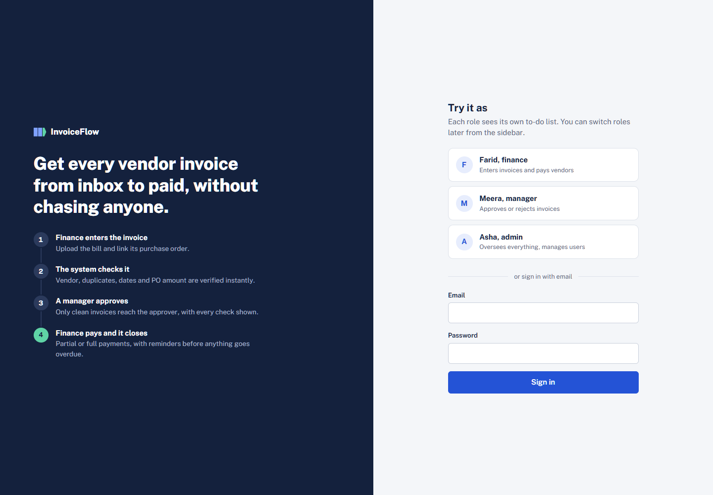 |
| Manager home: payment route and approval queue | 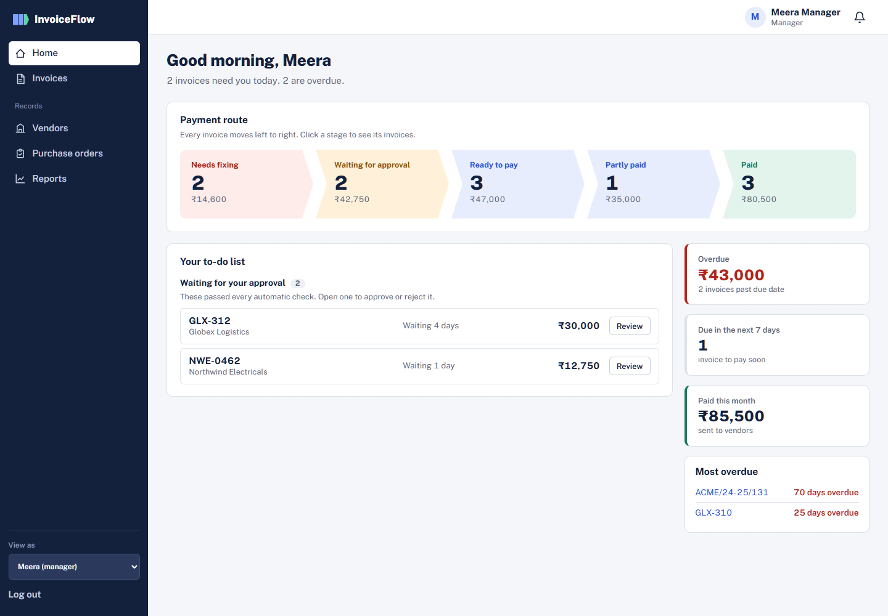 |
| Finance home: payments due, invoices to fix | 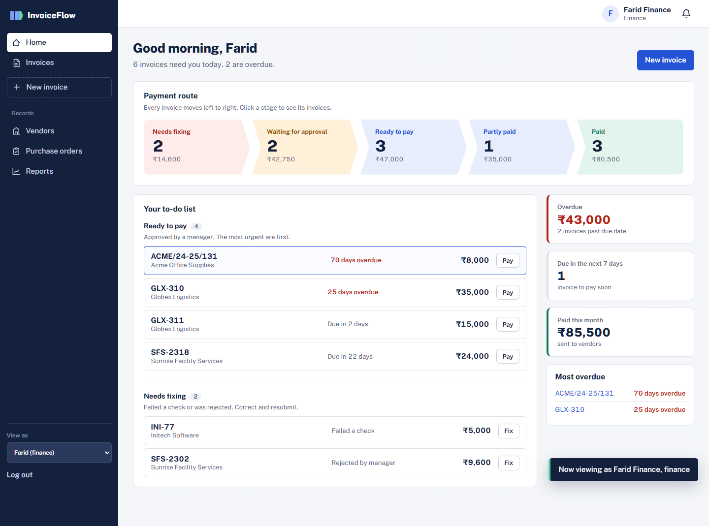 |
| Invoice waiting for approval: progress tracker, Next step, checks, activity | 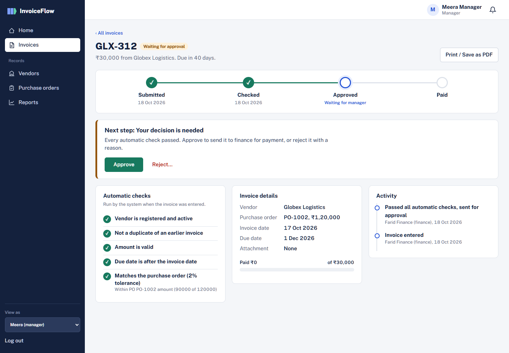 |
| Invoice ready to pay: payment form with balance filled in | 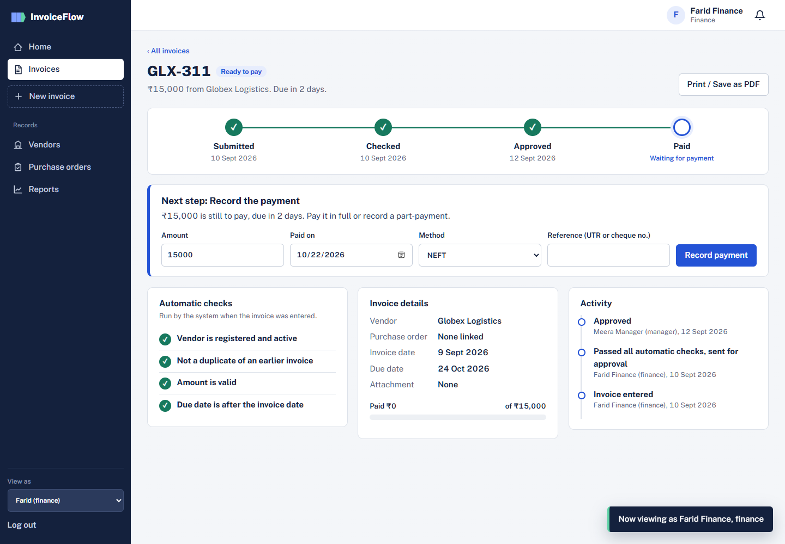 |
| Invoice list: stage tabs, search, overdue highlighting | 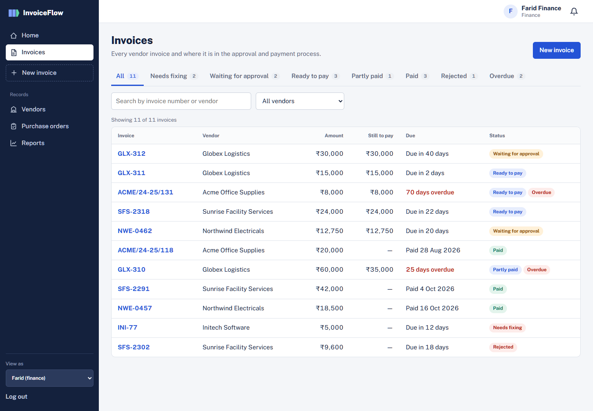 |
| New invoice: form beside the checks that will run | 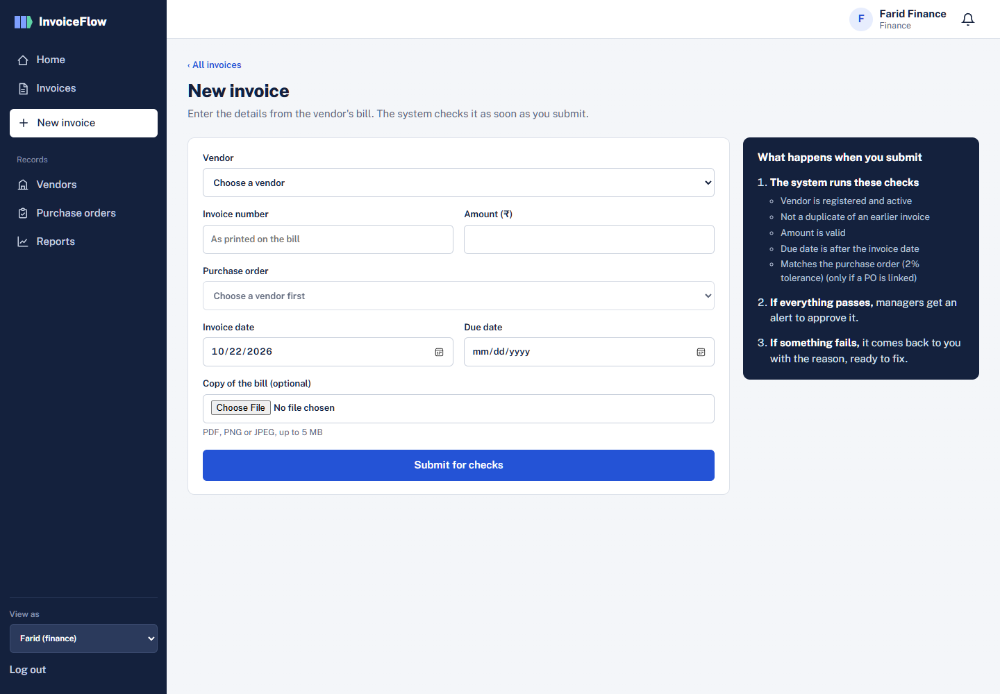 |
| Reports: overdue amounts, monthly payments, stages, top vendors | 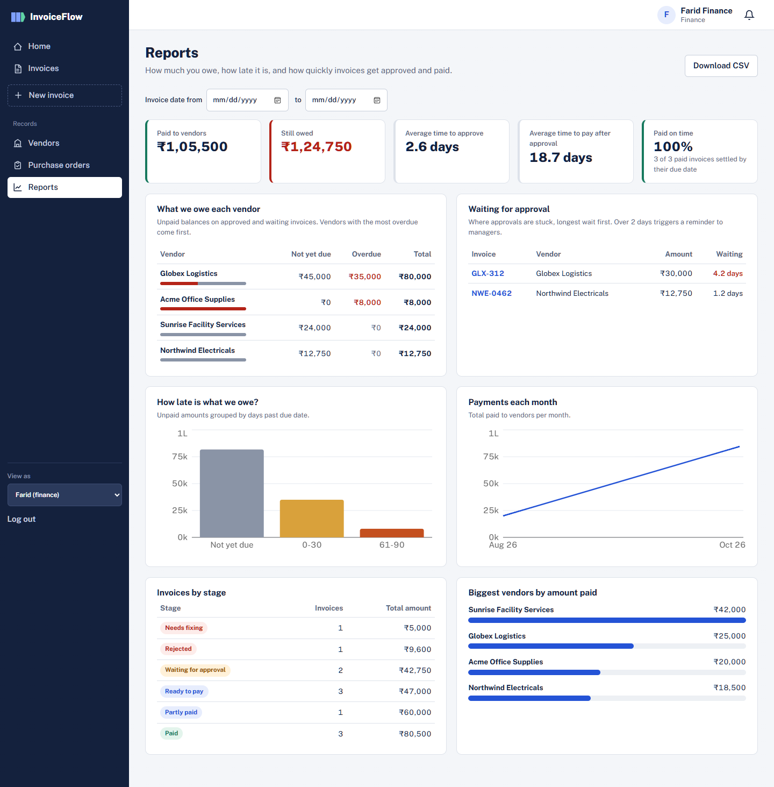 |
| Mobile layout (390 px) | 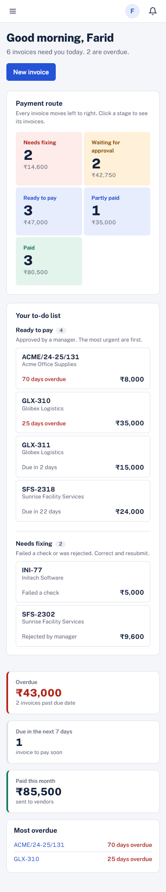 |
| Vendor page: totals, PO usage, invoices | 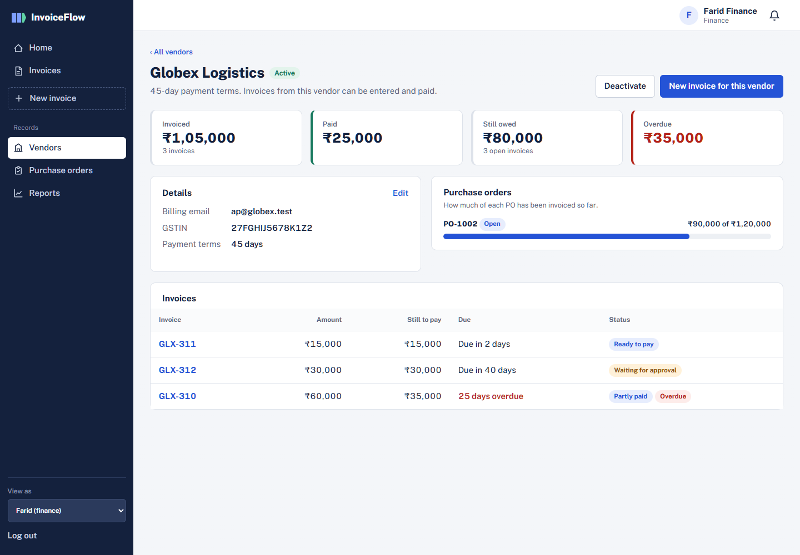 |
| Bill preview beside the checks, for the approver | 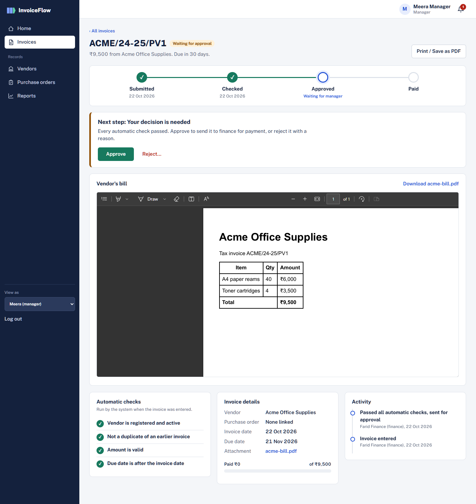 |

## 16. Conclusion

InvoiceFlow meets the problem statement:

- **Verification:** it runs automatically on every submission, using rules that are unit tested.
- **Payment status:** each invoice moves through a clear set of stages enforced by the server, with partial payments and protection against overpayment.
- **Reminders:** a scheduled job sends reminders without repeats.
- **Reporting:** reports cover what is owed, how overdue it is, and how long approval and payment take.

The interface is organised around the process itself. The payment route, each role's to-do list and the per-invoice **Next step** panel tell every user what is waiting on them. The project uses the full MERN stack:
- a REST API with JWT and role-based access
- document modelling with embedded sub-documents
- aggregation pipelines for the reports
- scheduled jobs
- file uploads
- optimistic concurrency
- unit, API and browser tests

## 17. Future enhancements

1. **Email and SMS reminders:** send the existing notifications through email (Nodemailer) and SMS, in addition to the in-app alerts.
2. **OCR:** read the vendor, invoice number, dates and amount from the uploaded bill to pre-fill the form.
3. **Vendor portal:** let vendors submit invoices and see their payment status themselves.
4. **Multiple currencies:** a currency per invoice, with exchange rates for reporting.
5. **Deployment:** host the API and the built React app (for example on Render or Railway with Atlas), with HTTPS and CI.
6. **Cancel a rejected invoice:** a *cancelled* status so a rightly rejected invoice leaves Finance's to-do list.
7. **Approval limits:** multi-level approval above a configurable amount.
8. **Payment gateway and bank file export:** pay vendors directly, or generate NEFT/RTGS bulk files.
9. **Audit and compliance:** GST validation of the GSTIN format and of tax amounts.

## 18. References

1. MongoDB Manual, Aggregation Pipeline: https://www.mongodb.com/docs/manual/aggregation/
2. MongoDB Atlas, IP Access List: https://www.mongodb.com/docs/atlas/security/ip-access-list/
3. Mongoose documentation, Schemas and Optimistic Concurrency: https://mongoosejs.com/docs/guide.html#optimisticConcurrency
4. Express 5 documentation: https://expressjs.com/
5. React documentation: https://react.dev/
6. Vite documentation, Server Proxy: https://vite.dev/config/server-options#server-proxy
7. RFC 7519, JSON Web Token (JWT): https://datatracker.ietf.org/doc/html/rfc7519
8. OWASP, CSV Injection: https://owasp.org/www-community/attacks/CSV_Injection
9. node-cron: https://www.npmjs.com/package/node-cron
10. Recharts: https://recharts.org/
11. Playwright: https://playwright.dev/
